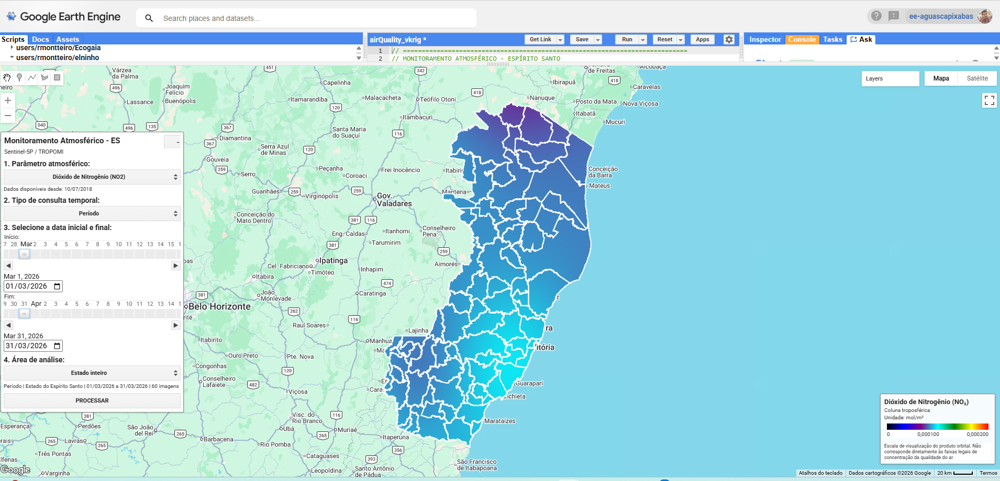
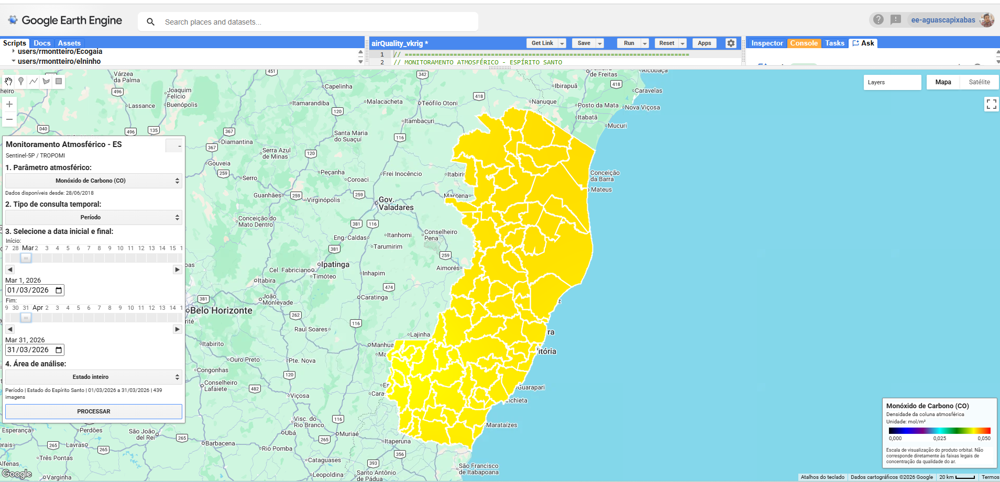
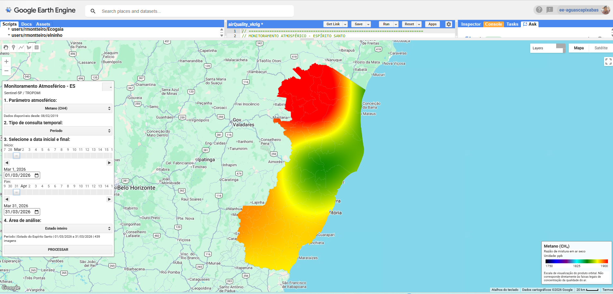

# Monitoramento Atmosférico do Espírito Santo

Aplicação interativa para o Google Earth Engine (GEE) que visualiza produtos atmosféricos do sensor TROPOMI, a bordo do satélite Sentinel-5P, sobre o estado do Espírito Santo e seus municípios.

O painel permite escolher o parâmetro atmosférico, consultar um único dia ou um intervalo de datas e selecionar todo o estado ou um município. Para cada consulta, o script filtra a coleção, calcula a média temporal das imagens disponíveis, aplica uma suavização espacial e apresenta o resultado em escala logarítmica.

## Resultados ilustrativos

As capturas abaixo mostram consultas para todo o Espírito Santo no período de 1º a 31 de março de 2026.

*Dióxido de nitrogênio (NO₂): média de 60 imagens da coluna troposférica.*

*Monóxido de carbono (CO): média de 439 imagens da densidade da coluna atmosférica.*

*Metano (CH₄): média de 439 imagens da razão de mistura em ar seco, com destaque para o efeito da suavização espacial.*

As capturas registram a execução que motivou esta atualização. No script versionado, a legenda também identifica explicitamente a transformação `log10` e posiciona o valor central de acordo com a escala transformada.

## Metodologia

A aplicação executa uma análise exploratória de constituintes atmosféricos em seis etapas:

1. Carrega os limites municipais e combina suas geometrias para representar o território estadual.
2. Seleciona a coleção e a banda correspondentes ao parâmetro atmosférico escolhido.
3. Filtra as imagens pelo intervalo temporal e pela interseção com o estado ou município selecionado.
4. Calcula a média temporal, pixel a pixel, das observações disponíveis.
5. Aplica reamostragem bicúbica, média focal gaussiana com raio de 2 km e transformação `log10` deslocada pelo mínimo configurado.
6. Recorta e exibe o raster, o contorno territorial, a escala de cores e a quantidade de imagens utilizadas.

No modo **Um dia**, o intervalo vai da data escolhida até o início do dia seguinte. No modo **Período**, a data final informada também é incluída. Esse tratamento é necessário porque o limite final de `filterDate()` é exclusivo no Earth Engine.

Por padrão, o painel sugere uma data dez dias anterior à execução. Para consultas por período, a janela inicial abrange os 30 dias anteriores a essa data de referência. A defasagem reduz a chance de consultar produtos que ainda não foram disponibilizados, sem garantir que todos os pixels possuam observações válidas.

### Bases de dados

Os parâmetros atmosféricos provêm de produtos de nível 3 do sensor TROPOMI, a bordo do Sentinel-5P:

| Parâmetro | Coleção no Earth Engine | Banda | Produto | Unidade |
| --- | --- | --- | --- | --- |
| Monóxido de carbono (CO) | `COPERNICUS/S5P/OFFL/L3_CO` | `CO_column_number_density` | OFFL | mol/m² |
| Dióxido de nitrogênio (NO₂) | `COPERNICUS/S5P/NRTI/L3_NO2` | `tropospheric_NO2_column_number_density` | NRTI | mol/m² |
| Formaldeído (HCHO) | `COPERNICUS/S5P/NRTI/L3_HCHO` | `tropospheric_HCHO_column_number_density` | NRTI | mol/m² |
| Dióxido de enxofre (SO₂) | `COPERNICUS/S5P/NRTI/L3_SO2` | `SO2_column_number_density` | NRTI | mol/m² |
| Metano (CH₄) | `COPERNICUS/S5P/OFFL/L3_CH4` | `CH4_column_volume_mixing_ratio_dry_air` | OFFL | ppb |
| Ozônio (O₃) | `COPERNICUS/S5P/NRTI/L3_O3` | `O3_column_number_density` | NRTI | mol/m² |
| Índice de aerossóis absorventes | `COPERNICUS/S5P/NRTI/L3_AER_AI` | `absorbing_aerosol_index` | NRTI | adimensional |

Os limites territoriais são fornecidos pelo asset `projects/ee-aguascapixabas/assets/MUNICIPIOS_ES`. O estado corresponde à geometria conjunta das feições; a seleção municipal filtra o atributo `nome`.

`OFFL` identifica produtos processados em modo offline, enquanto `NRTI` identifica produtos disponibilizados próximos ao tempo real. Essa diferença deve ser considerada ao comparar a atualidade e a consistência dos parâmetros.

### Suavização espacial e escala logarítmica

A continuidade visual resulta de duas operações: `resample('bicubic')` durante a reprojeção e `focalMean()` com kernel gaussiano de 2 km. Esse processamento reduz transições abruptas entre pixels, mas também altera a aparência espacial do produto original.

O procedimento **não constitui krigagem geoestatística**: não há amostragem pontual, ajuste de semivariograma, parâmetros de efeito pepita, patamar ou alcance, nem estimativa da variância de predição. Uma implementação de krigagem exigiria a definição e validação desses elementos para cada variável e período.

Para a renderização logarítmica, o código desloca cada valor pelo mínimo da faixa, adiciona 1% da amplitude como constante positiva e aplica `log10`. Esse deslocamento permite processar o índice de aerossóis, que admite valores negativos. A transformação serve apenas à visualização; unidades e valores científicos permanecem os do produto original.

### Limitações de interpretação

- O resultado é uma média temporal por pixel, sem cálculo de estatísticas municipais ou séries temporais.
- O script não aplica filtros adicionais de qualidade, incerteza ou cobertura de nuvens além das máscaras presentes nos produtos do catálogo.
- Grandezas de coluna atmosférica não correspondem diretamente às concentrações medidas na superfície.
- As escalas de cores controlam a visualização e não representam padrões legais de qualidade do ar.
- A suavização pode sugerir continuidade onde não existem observações independentes e não deve ser interpretada como aumento da resolução do sensor.
- A escala logarítmica amplia o contraste dos menores valores e comprime os maiores.
- A média simples atribui o mesmo peso a todas as observações válidas.
- O resultado não é exportado ou persistido fora da sessão do GEE.

Uma discussão ampliada das datas iniciais, faixas de visualização e cuidados de uso está disponível em [`docs/metodologia.md`](docs/metodologia.md).

## Estrutura

- `gee/monitoramento_atmosferico_es.js`: aplicação pronta para o Code Editor do GEE.
- `docs/metodologia.md`: roteiro metodológico, bases utilizadas, parâmetros e limitações.
- `docs/images/`: capturas ilustrativas das consultas de NO₂, CO e CH₄.

## Como executar

1. Abra o [Google Earth Engine Code Editor](https://code.earthengine.google.com/).
2. Crie um novo script e cole o conteúdo de `gee/monitoramento_atmosferico_es.js`.
3. Confirme que sua conta possui acesso ao asset `projects/ee-aguascapixabas/assets/MUNICIPIOS_ES`.
4. Execute o script e configure a consulta no painel exibido no mapa.

O asset municipal precisa conter o campo `nome`, usado para preencher a lista de municípios. O código depende dos objetos globais `ee`, `ui`, `Map` e `print` disponibilizados pelo Code Editor e, por isso, não é executável diretamente em Node.js.
